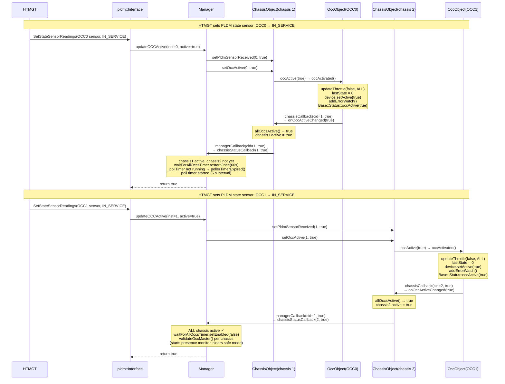
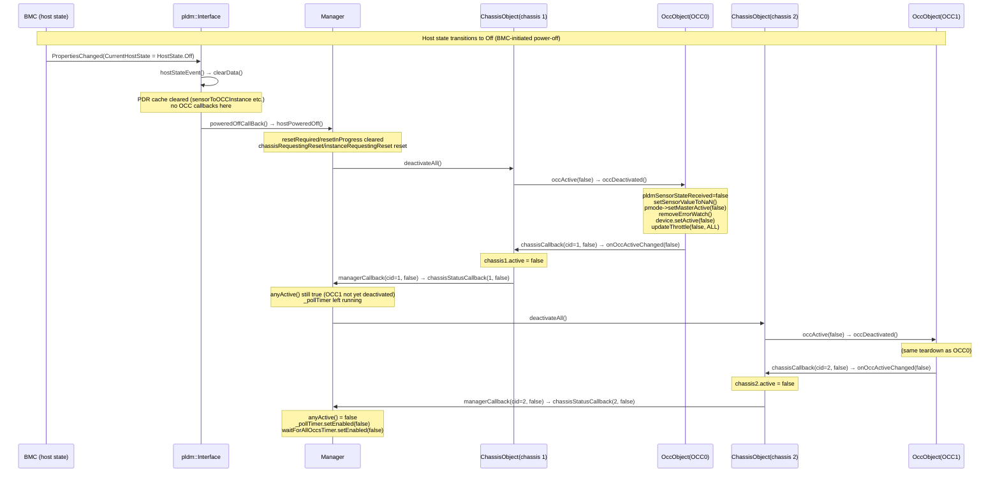
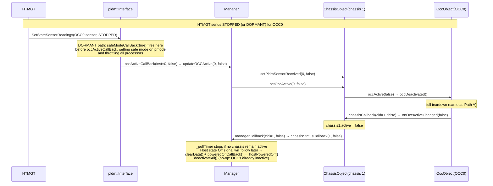

# OCC Host Activation and Deactivation

This document describes what happens when the host starts up and shuts down with
respect to OCC activation and deactivation.

**Pre-condition:** `Manager` has already created `OccObject` and `ChassisObject`
instances for all discovered OCCs (e.g. OCC0 on chassis 1, OCC1 on chassis 2).

---

## Activation Sequence

When the host starts, HTMGT sets the PLDM state sensor for each OCC to
`IN_SERVICE`. The `pldm::Interface` receives the sensor event and calls
`Manager::updateOCCActive()` for each OCC.

### Step-by-Step Description

#### OCC0 activation (chassis 1)

1. **HTMGT → `pldm::Interface`**: HTMGT sends a PLDM `SetStateSensorReadings`
   message over MCTP with `IN_SERVICE` for OCC0's sensor.

2. **`pldm::Interface` → `Manager::updateOCCActive(0, true)`**: The PLDM
   interface fires the `occActiveCallBack` registered at construction time.

3. **Manager → `ChassisObject::setPldmSensorReceived(0, true)`**: Records that
   the PLDM sensor state has been received for OCC0. This flag is used by
   `isSensorResolved()` to avoid re-querying PLDM once the state has already
   arrived.

4. **Manager → `ChassisObject::setOccActive(0, true)`**: Delegates to
   `OccObject::occActive(true)` → `occActivated()`:
   - Clears any prior throttle reason (`updateThrottle(false, THROTTLED_ALL)`)
   - Resets `lastState = 0`
   - Binds the kernel device (`device.setActive(true)`)
   - Starts error/throttle watching (`addErrorWatch()`)
   - Sets the D-Bus `occActive` property to `true`

5. **`OccObject` → `ChassisObject::onOccActiveChanged(true)`**: OccObject fires
   `chassisCallback`. Since this is the only OCC on chassis 1, `allOccsActive()`
   returns `true` and `chassis1.active` is set.

6. **`ChassisObject` → `Manager::chassisStatusCallback(1, true)`**:
   - chassis 1 is active but chassis 2 is not yet — starts `waitForAllOccsTimer`
     (60 s)
   - Poll timer is not yet running → calls `pollerTimerExpired()` which starts
     the 5 s poll cycle

#### OCC1 activation (chassis 2)

Steps 7–12 mirror OCC0's flow through chassis 2.

On `chassisStatusCallback(2, true)` the Manager sees **all** chassis are now
active:

- Stops `waitForAllOccsTimer`
- Calls `validateOccMaster()` for each chassis, which starts presence monitoring
  and clears safe mode (`pmode->updateDbusSafeMode(false)`)

---

## Deactivation Sequences

### Path A — Normal shutdown (BMC-driven)

The BMC initiates a power-off. The host state D-Bus property transitions to
`Off`. `pldm::Interface` receives the `PropertiesChanged` signal, calls
`clearData()` to wipe the PDR cache, then calls `poweredOffCallBack()` which
invokes `Manager::hostPoweredOff()`. The Manager is the single point that drives
OCC deactivation via `deactivateAll()` on each chassis.

---

### Path B — OCC failure (host-side STOPPED or DORMANT sensor)

HTMGT sends a `SetStateSensorReadings` with `STOPPED` or `DORMANT` for an OCC,
indicating an OCC has failed. This is an error/recovery event, not a planned
shutdown.

- **`STOPPED`** — OCC has stopped; deactivates the OCC only.
- **`DORMANT`** — OCC has stopped and the system has entered **safe mode**;
  additionally fires `safeModeCallBack(true)` before deactivating.

The host state Off signal will arrive later and clean up the PDR cache via
`clearData()`, followed by `poweredOffCallBack()` → `hostPoweredOff()` →
`deactivateAll()` (which will be a no-op since the OCCs are already inactive).

---

### OccObject teardown detail (`occDeactivated`)

All deactivation paths reach `OccObject::occDeactivated()` which performs these
steps in order:

| Step | Action                                                                          |
| ---- | ------------------------------------------------------------------------------- |
| 1    | Clear `pldmSensorStateReceived`, `pcapBoundsUpdated`, `stateValid`              |
| 2    | If sensors were valid: `setSensorValueToNaN()` (marks D-Bus sensors NaN)        |
| 3    | If master OCC: `pmode->setMasterActive(false)` (blocks mode changes)            |
| 4    | Stop `safeStateDelayTimer` if running                                           |
| 5    | `removeErrorWatch()` — stops throttle/error file descriptor watching            |
| 6    | `device.setActive(false)` — unbinds the kernel OCC device                       |
| 7    | Fire `chassisCallback(cid, false)` → `ChassisObject::onOccActiveChanged(false)` |
| 8    | `updateThrottle(false, THROTTLED_ALL)` — clears processor throttle D-Bus state  |
| 9    | `MyPollHandler->clearOccPollTraceFlags()`                                       |

---

## Key Invariants

| Condition                                                     | Behaviour                                                                                                                                           |
| ------------------------------------------------------------- | --------------------------------------------------------------------------------------------------------------------------------------------------- |
| Host not yet running when `IN_SERVICE` arrives                | `updateOCCActive` clears `pldmSensorReceived`, skips `setOccActive`, restarts `discoverTimer` (30 s)                                                |
| Only one chassis active after both sensors arrive             | `waitForAllOccsTimer` fires after 60 s; `occsNotAllRunning()` calls `validateOccMaster()` anyway (guards may mean fewer OCCs than expected)         |
| `pldmSensorStateReceived` set by HRESET or queued-state paths | It is **not** — those paths call `setOccActive` directly and do not touch the flag, preserving its meaning as "PLDM has delivered a sensor reading" |
| Normal shutdown deactivation                                  | `clearData()` only wipes the PDR cache; `hostPoweredOff()` → `deactivateAll()` is the single point of OCC deactivation                              |
