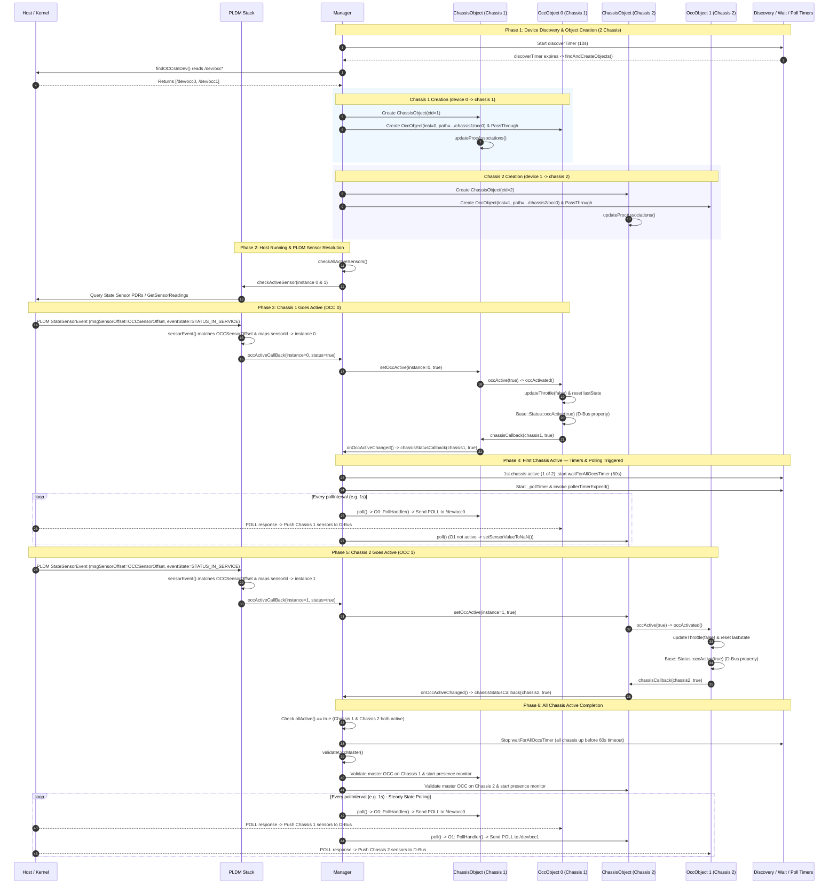

# OCC Detection and Activation (2-Chassis Configuration)

## Overview

This document describes how OCCs (On-Chip Controllers) are discovered in `/dev`,
instantiated across multiple chassis, resolved via PLDM sensors, and
transitioned to the active state in `openpower-occ-control` for a **2-chassis**
system.

In a 2-chassis system:

- `/dev/occ0` maps to **Chassis 1** (`.../chassis1/occ0`, OCC instance 0).
- `/dev/occ1` maps to **Chassis 2** (`.../chassis2/occ0`, OCC instance 1).

---

## Timing and Sequence Diagram (2 Chassis)

---

## Detailed Step-by-Step Lifecycle (2 Chassis)

### 1. Device Discovery & Object Creation

- **Scanning `/dev`**: `Manager::findOCCsInDev()` discovers both `/dev/occ0` and
  `/dev/occ1`.
- **Instantiation**:
  - **Chassis 1**: `Manager::createObjects(0)` instantiates `ChassisObject` for
    `chassis1` and `OccObject` for OCC instance 0 at D-Bus path
    `/xyz/openbmc_project/control/chassis1/occ0`.
  - **Chassis 2**: `Manager::createObjects(1)` instantiates `ChassisObject` for
    `chassis2` and `OccObject` for OCC instance 1 at D-Bus path
    `/xyz/openbmc_project/control/chassis2/occ0`.
  - `PassThrough` objects are registered for `/dev/occ0` and `/dev/occ1`.
  - Processor associations are updated via
    `ChassisObject::updateProcAssociations()` for each chassis.

### 2. Host Running & PLDM Sensor Resolution

- When the host reaches the running state (`utils::isHostRunning()`),
  `Manager::checkAllActiveSensors()` checks sensor resolution for both
  `chassis1` and `chassis2`.
- Queries PLDM (`pldm::Interface::checkActiveSensor()`) to obtain state sensor
  PDRs and current sensor states for both OCC 0 and OCC 1.

### 3. Chassis 1 (OCC 0) Activation

- Host sends a PLDM state sensor event for OCC 0.
- `pldm::Interface::sensorEvent(msg)` receives the signal on
  `/xyz/openbmc_project/pldm`:
  - Matches `msgSensorOffset == OCCSensorOffset`.
  - Resolves `sensorId` to OCC instance 0.
  - Identifies
    `eventState == PLDM_STATE_SET_OPERATIONAL_RUNNING_STATUS_IN_SERVICE`
    (`STATUS_IN_SERVICE`).
  - Calls `occActiveCallBack(0, true)`.
- `Manager::updateOCCActive(0, true)` locates `chassis1` and calls
  `ChassisObject::setOccActive(0, true)`:
  - `OccObject::occActivated()` clears throttles
    (`updateThrottle(false, THROTTLED_ALL)`), resets `lastState`, and sets D-Bus
    property `occActive` to `true`.
  - `ChassisObject::onOccActiveChanged(true)` sets `chassis1` status to active
    and notifies `Manager::chassisStatusCallback(1, true)`.

### 4. First Chassis Active Handling & Polling

- Because `chassis1` is the first chassis to go active (`activeCount == 1` out
  of 2):
  - `waitForAllOccsTimer` is started with a 60-second timeout to allow
    `chassis2` time to come up.
  - Polling timer (`_pollTimer`) is started, kicking off periodic polling
    (`pollerTimerExpired()`).
  - In this intermediate state, `chassis1` polls `/dev/occ0` and pushes live
    sensor data to D-Bus, while `chassis2` sets its unactivated sensors to
    `NaN`.

### 5. Chassis 2 (OCC 1) Activation

- Host sends a PLDM state sensor event for OCC 1.
- `pldm::Interface::sensorEvent(msg)` verifies
  `msgSensorOffset == OCCSensorOffset`, maps `sensorId` to OCC instance 1, and
  verifies `STATUS_IN_SERVICE`.
- `Manager::updateOCCActive(1, true)` routes to `chassis2` and sets
  `OccObject 1` to active.
- `ChassisObject::onOccActiveChanged(true)` sets `chassis2` active and invokes
  `Manager::chassisStatusCallback(2, true)`.

### 6. Full 2-Chassis Active Completion

- `Manager::chassisStatusCallback()` checks `allActive()`:
  - Both `chassis1` and `chassis2` are now active.
  - `waitForAllOccsTimer` is stopped (cancelling the 60s timeout).
  - `Manager::validateOccMaster()` verifies the master OCC per chassis and
    starts OCC presence monitoring on each chassis.
  - Steady-state polling now continuously queries both `/dev/occ0` and
    `/dev/occ1` every poll cycle (`pollInterval`), parsing OCC responses and
    updating D-Bus sensors.
